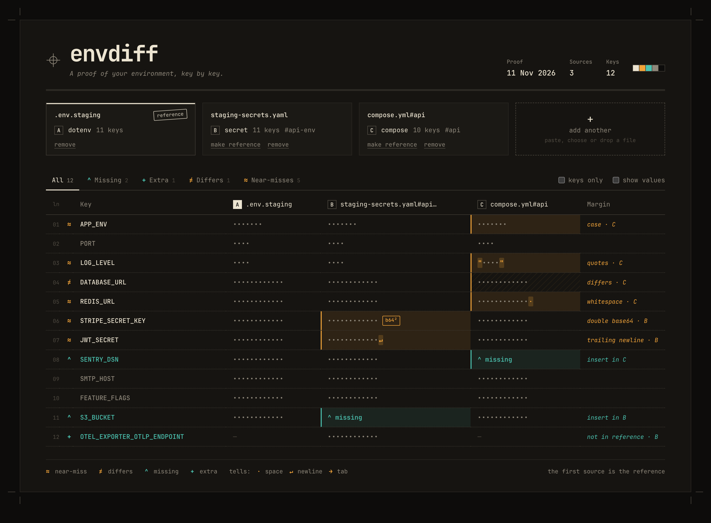
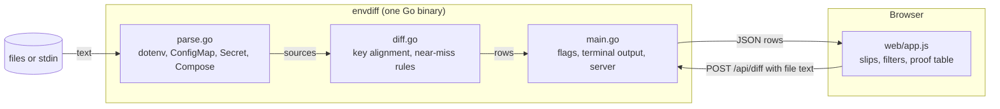

# envdiff

<p align="center"><a href="https://preacherxp.github.io/30-days-of-tools/"></a></p>

<p align="center"><a href="https://buymeacoffee.com/michal.hachula"></a></p>

A command line tool and local web UI that compares environment variables across `.env` files, Kubernetes ConfigMaps and Secrets, and Docker Compose services, and names the near-misses that look identical but aren't.

You give it a reference and one or more files to check: `envdiff .env.staging k8s/secrets.yaml compose.yml#api`. It works out each file's format, decodes Secret data, and lines every key up. A missing key or an extra one is easy to spot. envdiff also catches the values that differ only by a trailing newline from `echo`, a stray space, literal quotes in a Compose list, a change of case, or base64 encoded twice, and it says which. It exits with 1 when anything differs, so it fits in CI. `envdiff serve` shows the same comparison as a side-by-side proof sheet in your browser. Values stay hidden until you ask for them.

<p align="center"></p>

## Requirements

- macOS, Linux or Windows
- A current Chrome, Firefox or Safari for `envdiff serve`
- Go 1.24 or later to build it

## Install

```sh
go install github.com/preacherxp/envdiff@latest
```

Or from source:

```sh
git clone https://github.com/preacherxp/envdiff.git
cd envdiff
go build -o envdiff .
```

To update, run `go install github.com/preacherxp/envdiff@latest` again. To uninstall, delete the binary: `rm "$(go env GOPATH)/bin/envdiff"`.

## Usage

```sh
envdiff .env.example .env --keys                  # same keys? ignore the placeholder values
envdiff .env.staging k8s/secrets.yaml             # every key and value, Secret data decoded
envdiff .env compose.yml#api                      # one Compose service; without #api, every service
envdiff k8s/app.yaml#app-config k8s/app.yaml#app-secrets
kubectl get secret api-env -o yaml | envdiff .env -   # - reads stdin
envdiff a.env b.env --show                        # print the values too
envdiff a.env b.env --json                        # the whole comparison as JSON
envdiff serve .env.staging k8s/secrets.yaml       # open the web UI with these files
```

The first source is the reference, and every other source is compared against it. Matching keys are hidden in the terminal unless you pass `--all`. Exit codes are `0` when every key matches, `1` when anything differs and `2` for an error such as an unreadable file. Colour is turned off when the output isn't a terminal or `NO_COLOR` is set.

```text
dotenv    .env.staging  11 keys  reference
secret    staging-secrets.yaml#api-env  11 keys
compose   compose.yml#api  10 keys

≈ APP_ENV                      case in compose.yml#api
≈ LOG_LEVEL                    quotes in compose.yml#api
≠ DATABASE_URL                 differs in compose.yml#api
≈ REDIS_URL                    whitespace in compose.yml#api
≈ STRIPE_SECRET_KEY            double base64 in staging-secrets.yaml#api-env
≈ JWT_SECRET                   trailing newline in staging-secrets.yaml#api-env
^ SENTRY_DSN                   missing in compose.yml#api
^ S3_BUCKET                    missing in staging-secrets.yaml#api-env
+ OTEL_EXPORTER_OTLP_ENDPOINT  only in staging-secrets.yaml#api-env

12 keys · 3 same · 2 missing · 1 extra · 5 near-miss · 1 differs
```

- **Formats.** A file holding a `ConfigMap` or `Secret` (several documents with `---` are fine) gives one source per object. A file with `services:` gives one source per service that has an `environment:`, in either the list or the map form, with YAML anchors and `<<` merges resolved. Anything else is read as dotenv: `export`, comments, single and double quotes, escapes, and quoted values over several lines.
- **Picking one.** Add `#name` after a path to compare one object or service: `compose.yml#worker`, `k8s.yaml#api-env`.
- **Near-miss.** The value matches the reference once one thing is ignored: a trailing newline, surrounding whitespace, surrounding quotes, letter case, or a second layer of base64. Each one is a bug that a quick look at the values won't show.
- **Keys only.** `--keys` checks only which keys exist, for files such as `.env.example` whose values are placeholders.

### Web UI

`envdiff serve [FILE...]` starts a server on `127.0.0.1` with a random port, prints the address and opens your browser. Each file is a slip at the top. **make reference** moves a file to the front and **remove** drops it. Add more with **add another**: paste text, choose files, or drop them anywhere on the page. The tabs filter the table to **Missing**, **Extra**, **Differs** or **Near-misses**, and **keys only** works like `--keys`.

Values are masked until you tick **show values**. Even masked, the characters that cause a near-miss stay visible in amber: `·` for a space, `↵` for a newline, `→` for a tab, and any stray quotes. A trailing newline is visible without revealing the secret.

<p align="center"></p>

Nothing leaves your machine. Files you drop are held by the page and sent only to the envdiff process that served it, which keeps nothing on disk. The server answers only requests that carry the random token from the address it printed, from its own origin.

Flags for `serve`: `--addr` to choose the listen address (default `127.0.0.1:0`, keep it on loopback) and `--no-open` to skip opening the browser.

## Limits

- Compose `env_file:` is not read, and `${VAR}` interpolation is compared as written, not expanded. A key with no value (`- KEY` or `KEY:`), which Compose takes from your shell, counts as an empty value.
- dotenv `${VAR}` references are not expanded either.
- Helm templates, Kustomize overlays and `kind: List` are not parsed. Render them first (`helm template`, `kubectl kustomize`) and pipe the result in with `-`. Secret `binaryData` is skipped.
- A near-miss names one cause. A value with two at once, such as different case and a trailing space, shows as **differs**.
- With YAML `<<` merges, keys are applied in file order, so a merge listed after an explicit key wins. Compose files almost always put the merge first.
- Masked values show their length up to 12 characters.

## Architecture



- **`parse.go`** turns each input into one or more sources: a name, a format and its keys in file order. YAML is read as `yaml.Node`, not into Go maps, so `1.10` stays `1.10` and `8080` isn't turned into a number. Text that isn't a manifest or a Compose file is read as dotenv.
- **`diff.go`** takes the union of keys in reference order and marks each one same, missing, extra, differs or near. It tries the near-miss rules in a fixed order, newline first, so the most specific cause is the one reported.
- **`main.go`** runs the CLI, or the `serve` HTTP server with `web/` embedded through `embed.FS`. The browser does no parsing of its own: it sends the files' text to `/api/diff`, so the web UI and the CLI always agree.
- **`web/`** is plain HTML, CSS and JavaScript with no build step. It is styled like a printer's proof: mono type, crop marks, line numbers, and margin notes in amber for value problems and teal for key problems.

## Development

```sh
go test ./...                                           # parsers, near-miss rules and the demo fixtures
go vet ./...
go run . testdata/demo/.env.staging testdata/demo/staging-secrets.yaml testdata/demo/compose.yml#api
scripts/screenshot.sh docs/proof.png 1440 1060 reveal=1 # render the web UI with headless Chrome at 2x
```

`testdata/demo/` holds the files shown in the screenshots, with one example of every finding. `scripts/screenshot.sh` builds envdiff, serves those files and captures the page. Set `CHROME=` to use a Chrome other than the one in `/Applications`.

## License

[MIT](LICENSE)

<sub>If it saves you from chasing one more invisible newline, you can [buy me a coffee](https://buymeacoffee.com/michal.hachula).</sub>
